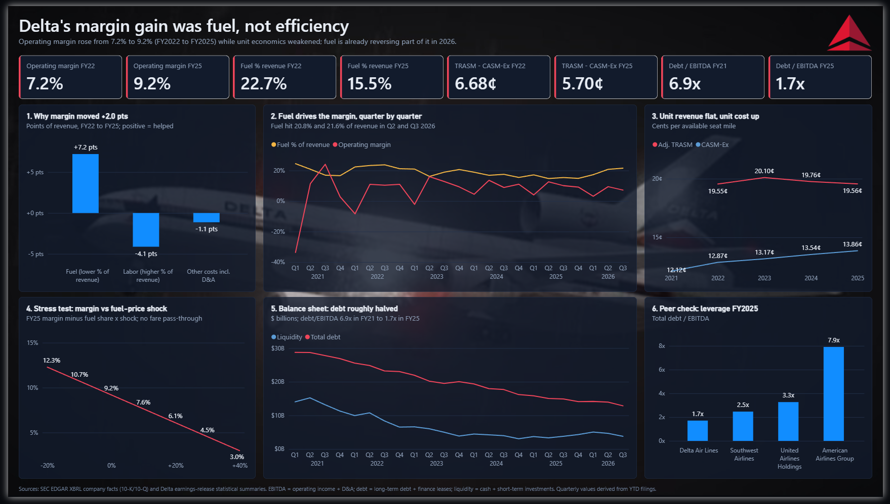
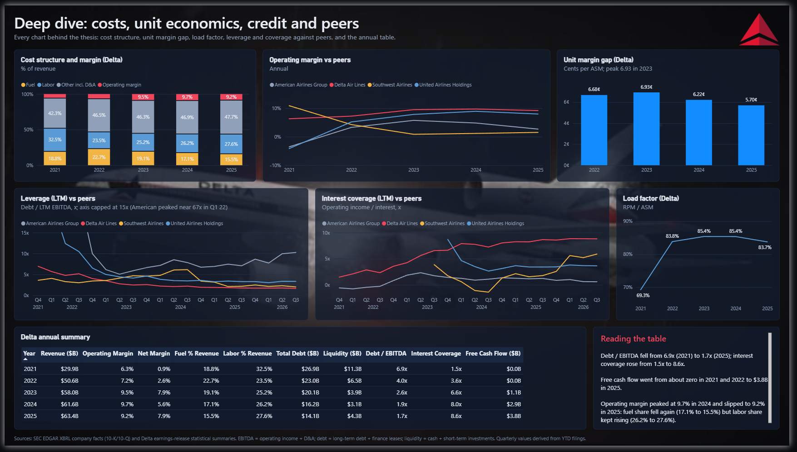
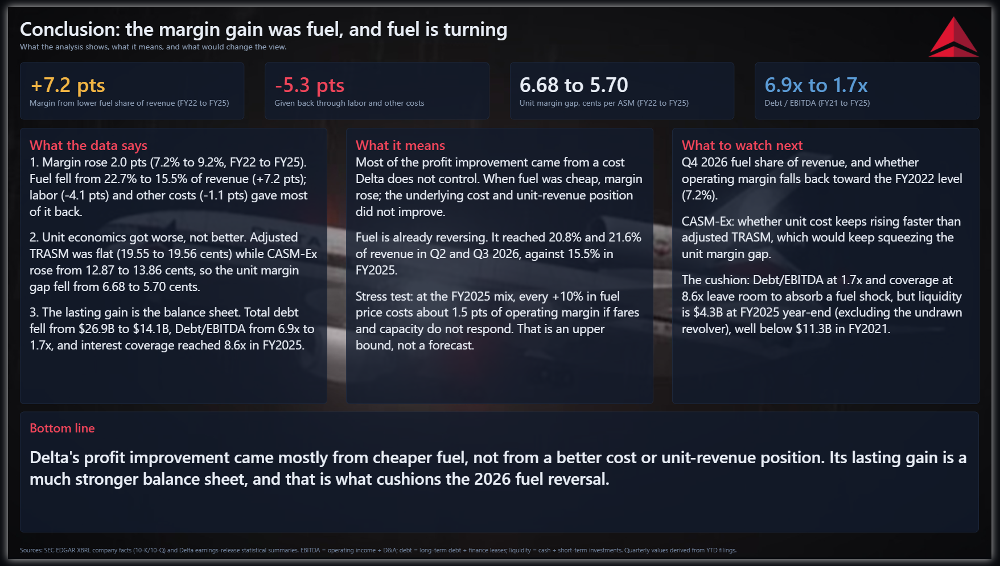
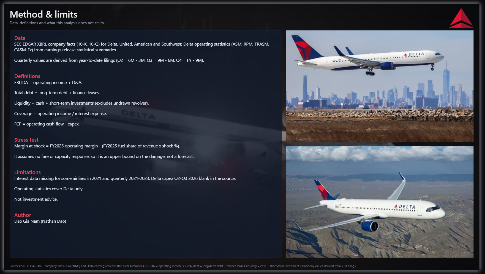
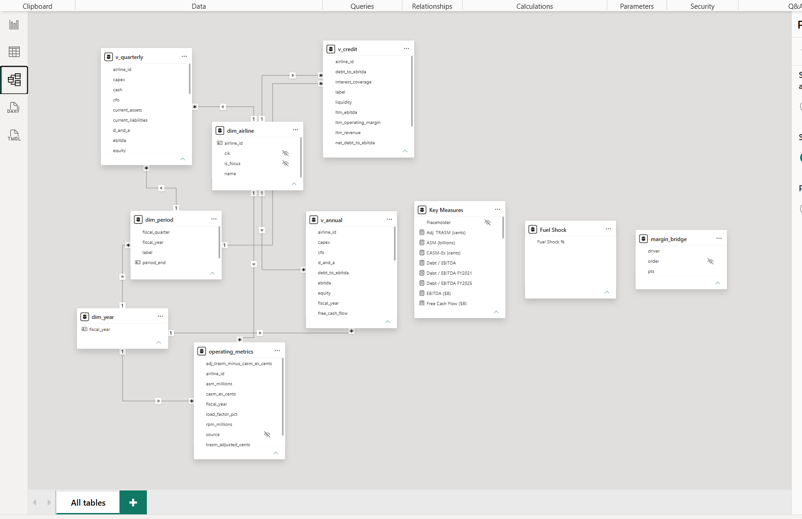

# Delta Air Lines: the margin gain was fuel, not efficiency (Power BI)

Power BI project (PBIP) analysing Delta Air Lines FY2021 to Q3 2026, with United, American and Southwest as peer benchmarks.

**Thesis:** Delta's operating margin rose from 7.2% to 9.2% (FY2022 to FY2025), but fuel explains +7.2 pts while labor and other costs took back 5.3 pts; unit margin fell from 6.68 to 5.70 cents; the lasting gain is the balance sheet (Debt/EBITDA 6.9x to 1.7x). Fuel is already reversing in 2026.

## Open it
1. Power BI Desktop: open `Delta_Airline.pbip` (enable *Power BI Project (.pbip) save option* in Preview features if prompted).
2. Set the data path: Transform data > Manage parameters > `DataFolder` = full path to this repo's `data\` folder with a trailing backslash (the default `C:\Delta_Airline\data\` is a placeholder).
3. Home > Refresh. Then File > Save as `.pbix` if you want a single file to share.

## Report pages

### 1. The thesis
Margin bridge, fuel vs margin by quarter, unit economics, fuel-shock stress test, balance sheet, peer leverage (shown at the top of this page).

### 2. Deep dive
Cost structure, margin vs peers, unit margin gap, leverage and coverage vs peers, load factor, annual table.

### 3. Conclusion
Findings, what they mean, what to watch.

### 4. Method & limits
Data, definitions, stress-test assumptions.

## Data model
Model view in Power BI Desktop.

Full column list: [docs/data_dictionary.md](docs/data_dictionary.md)

## Data (`data/`)
SEC EDGAR XBRL company facts (10-K/10-Q); Delta operating statistics (ASM, RPM, TRASM, CASM-Ex) from earnings-release statistical summaries. Quarterly values are derived from year-to-date filings.

## Definitions and limitations
EBITDA = operating income + D&A. Debt = long-term debt + finance leases. Liquidity = cash + short-term investments (excludes undrawn revolver). Coverage = operating income / interest. FCF = CFO - capex. Some interest data are missing for 2021 and quarterly 2021-2023; Delta capex Q2-Q3 2026 is blank in the source. Operating statistics cover Delta only. The stress test assumes no fare or capacity response, so it is an upper bound, not a forecast.

## Disclaimer
Independent analysis based on public filings. Not affiliated with or endorsed by Delta Air Lines. The Delta name, logo and aircraft photos shown in the report screenshots belong to their owners and are not included in the project files.
