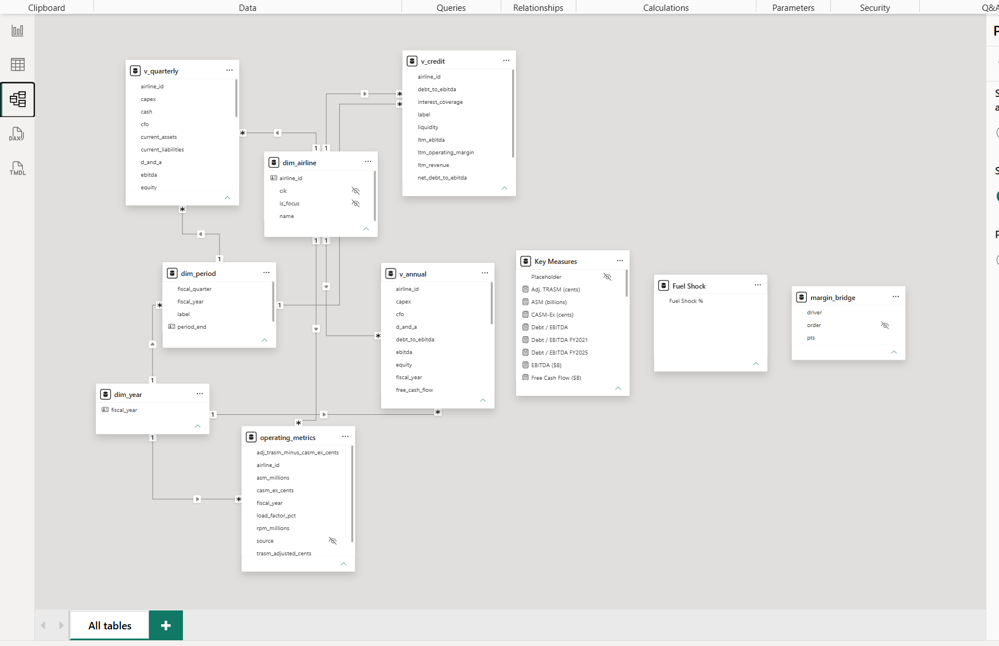

# Data dictionary

Model diagram: 

Star-style model: `dim_airline`, `dim_period`, `dim_year` filter the fact tables `v_quarterly`, `v_annual`, `v_credit` and `operating_metrics` (Delta only). `margin_bridge` and `Fuel Shock` feed the bridge and stress-test visuals; `Key Measures` holds the DAX measures.

## dim_airline.csv

| Column | Meaning |
|---|---|
| `airline_id` | Airline key (DAL, UAL, AAL, LUV) |
| `name` |  |
| `cik` |  |
| `is_focus` |  |

## dim_period.csv

| Column | Meaning |
|---|---|
| `period_end` | Quarter end date |
| `fiscal_year` | Fiscal year |
| `fiscal_quarter` | Quarter 1-4 |
| `label` | Period label, e.g. Q3 26 |
| `qlabel` |  |

## dim_year.csv

| Column | Meaning |
|---|---|
| `fiscal_year` | Fiscal year |

## margin_bridge.csv

| Column | Meaning |
|---|---|
| `driver` |  |
| `order` |  |
| `pts` |  |

## operating_metrics.csv

| Column | Meaning |
|---|---|
| `airline_id` | Airline key (DAL, UAL, AAL, LUV) |
| `fiscal_year` | Fiscal year |
| `asm_millions` |  |
| `rpm_millions` |  |
| `load_factor_pct` |  |
| `trasm_cents` |  |
| `trasm_adjusted_cents` |  |
| `casm_ex_cents` |  |
| `adj_trasm_minus_casm_ex_cents` |  |
| `source` |  |

## v_annual.csv

| Column | Meaning |
|---|---|
| `airline_id` | Airline key (DAL, UAL, AAL, LUV) |
| `fiscal_year` | Fiscal year |
| `revenue` | Total operating revenue ($) |
| `fuel_expense` | Aircraft fuel expense ($) |
| `labor_expense` | Salaries and related costs ($) |
| `d_and_a` | Depreciation and amortization ($) |
| `operating_income` | Operating income ($) |
| `net_income` | Net income ($) |
| `interest_expense` | Interest expense ($) |
| `interest_basis` |  |
| `cfo` | Operating cash flow ($) |
| `capex` | Capital expenditures ($) |
| `free_cash_flow` | CFO - capex ($) |
| `ebitda` | Operating income + D&A ($) |
| `operating_margin` | Operating income / revenue |
| `net_margin` |  |
| `fuel_pct_rev` | Fuel expense / revenue |
| `labor_pct_rev` | Labor expense / revenue |
| `liquidity` | Cash + short-term investments ($) |
| `total_debt` | Long-term debt + finance leases ($) |
| `debt_to_ebitda` | Total debt / LTM EBITDA |
| `net_debt_to_ebitda` | (Debt - cash) / LTM EBITDA |
| `interest_coverage` | LTM operating income / LTM interest |
| `equity` |  |
| `total_assets` |  |

## v_credit.csv

| Column | Meaning |
|---|---|
| `airline_id` | Airline key (DAL, UAL, AAL, LUV) |
| `period_end` | Quarter end date |
| `label` | Period label, e.g. Q3 26 |
| `ltm_revenue` |  |
| `ltm_ebitda` |  |
| `total_debt` | Long-term debt + finance leases ($) |
| `liquidity` | Cash + short-term investments ($) |
| `ltm_operating_margin` |  |
| `debt_to_ebitda` | Total debt / LTM EBITDA |
| `interest_coverage` | LTM operating income / LTM interest |
| `net_debt_to_ebitda` | (Debt - cash) / LTM EBITDA |

## v_quarterly.csv

| Column | Meaning |
|---|---|
| `airline_id` | Airline key (DAL, UAL, AAL, LUV) |
| `fiscal_year` | Fiscal year |
| `fiscal_quarter` | Quarter 1-4 |
| `label` | Period label, e.g. Q3 26 |
| `period_end` | Quarter end date |
| `revenue` | Total operating revenue ($) |
| `fuel_expense` | Aircraft fuel expense ($) |
| `labor_expense` | Salaries and related costs ($) |
| `d_and_a` | Depreciation and amortization ($) |
| `operating_income` | Operating income ($) |
| `net_income` | Net income ($) |
| `interest_expense` | Interest expense ($) |
| `ebitda` | Operating income + D&A ($) |
| `operating_margin` | Operating income / revenue |
| `net_margin` |  |
| `fuel_pct_rev` | Fuel expense / revenue |
| `labor_pct_rev` | Labor expense / revenue |
| `cfo` | Operating cash flow ($) |
| `capex` | Capital expenditures ($) |
| `free_cash_flow` | CFO - capex ($) |
| `cash` |  |
| `st_investments` |  |
| `liquidity` | Cash + short-term investments ($) |
| `current_assets` |  |
| `current_liabilities` |  |
| `equity` |  |
| `total_assets` |  |
| `total_debt` | Long-term debt + finance leases ($) |
